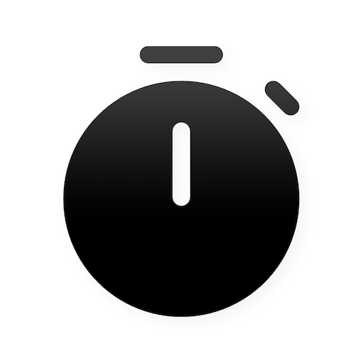
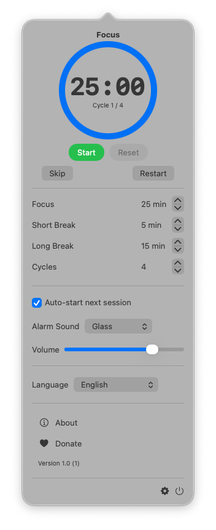
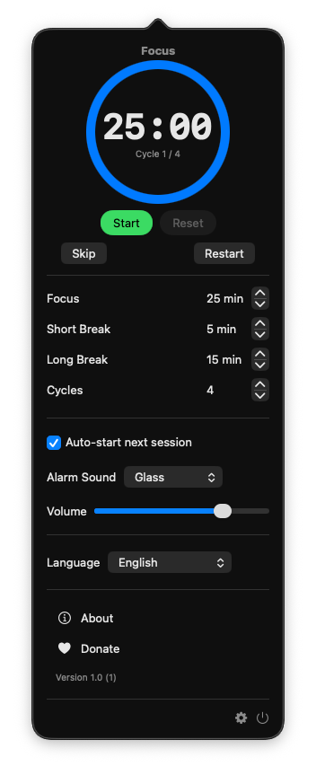

# TimeMate

<p align="center">
  
</p>

<p align="center">
  <b>A lightweight, menu bar Pomodoro timer for macOS</b>
</p>

<p align="center">
  <a href="https://homielab.com/en/page/timemate">Official Website</a> •
  <a href="https://github.com/homielab/timemate/issues">Report Issue</a> •
  <a href="https://ko-fi.com/homielab">Support Project</a>
</p>

---

## Overview

TimeMate is a clean, focused macOS application built around the Pomodoro Technique. Operating entirely from your menu bar, TimeMate helps you maintain deep focus and manage work-rest cycles without cluttering your desktop or Dock.

By alternating focused work sprints (e.g., 25 minutes) with short breaks (5 minutes) and scheduled long breaks, TimeMate promotes sustained concentration while preventing mental fatigue.

## Key Features

- **Menu Bar Integration**: Access your timer instantly from the macOS menu bar with zero desktop clutter. Right-click (or Control-click) the menu bar item for a quick menu: Start/Pause, Skip, Reset, Settings… and Quit. VoiceOver reads the item with the session and the time remaining, e.g. "TimeMate, Focus, 12 minutes, 34 seconds remaining". Hovering the item shows the same text as a tooltip, in every menu bar style. Settings → Appearance → Menu bar time picks "12:34", minutes only ("13m", for crowded menu bars) or icon only; the old `hideMenuBarTime` default is read once to pick the initial choice and then left untouched.
- **Automated Workflow**: Seamlessly cycles between Focus, Short Break, and Long Break sessions. A long break comes after every 2–8 focus sessions (default 4); "Auto-start breaks", "Auto-start focus" and "Auto-start on launch" keep the timer going without clicks.
- **Custom Session Durations**: Set any focus or break length from 1 to 180 minutes (e.g. 50/10 or 90-minute deep work) by typing it or with the stepper; an idle timer shows the new length right away.
- **Session Label**: Type what you're working on in the "What are you working on?" field under the cycle dots (focus sessions only). It is saved with each focus session you complete, as it was when the session started (editing it mid-session labels the next one) (a `label` in `session-history.json`), shown as the first line of the "session complete" notification, and kept until you change it, also across relaunches and Reset All Settings. Leave it empty for no label. Press Return to leave the field so **Space** starts/pauses again.
- **Subtle Notifications**: Receive gentle alerts when sessions complete without disruptive alarms. The banner shows even while TimeMate is in front, plays only your chosen alarm sound, says what comes next ("Next: Short Break · 5 min", or "… started" with auto-start), and has **Start Next** / **Skip** buttons (no Start Next when the next session starts by itself); clicking the banner opens the popover. Only the latest one stays in Notification Center, and it goes away once you start, skip, reset or restart, so its buttons never act on a later session. It is time-sensitive, so it still shows while a Focus mode or Do Not Disturb is on; turn off "Break through Focus" in Settings → Alerts & Sound to let Focus hide it.
- **Sounds**: Pick the alarm that plays when a focus session ends and, separately, the sound for the end of a break (until you choose one it follows the alarm), or **None** for silence — in Settings → Alerts & Sound, with a preview button and a shared volume.
- **VoiceOver**: The duration and cycle steppers are named ("Focus minutes", "Cycles"…), the cycle dots read as "2 of 4 focus sessions done" and the progress ring says how much of the session is left.
- **Full-Screen Break Overlay**: Optional immersive break screen that encourages taking genuine rest. The animation runs only on the screen you work on, stays still when Reduce Motion is on, and VoiceOver announces the break and reads its countdown. Need more rest? **+5 min** lengthens the break (and the popover's **+5 min** button lengthens a running or paused focus session, which the history records at its longer length); not a good moment? **Postpone** it by 1, 3 or 5 minutes and it comes back on its own. The Skip button (and Esc twice) works after a delay you set in Settings → Alerts & Sound (0–30 s, default 5 s). While the app in front is full screen (a presentation, a video) the break screen waits until you leave it; turn that off in the same section.
- **Statistics**: See how many pomodoros and focus minutes you completed today. Settings → Statistics shows the last 7 days (pomodoros and focus minutes per day, read day by day by VoiceOver) or, with the **7 days / 30 days** switch (remembered), the last 30 days as a compact bar strip; below it the period's total and the change against the same number of days before (pomodoros, percent, minutes; hidden when there is nothing to compare with). **Export CSV…** saves the chosen period, one row per day, as `date,pomodoros,minutes`; **Export sessions CSV…** saves one row per completed session of the last 90 days as `start,end,kind,minutes,label` (ISO 8601 times, kind `focus`/`short_break`/`long_break`, your session label quoted, with a leading `'` if it starts with `=`, `+`, `-` or `@`). Completed sessions are kept for 90 days in a local JSON file (`~/Library/Containers/<bundle id>/Data/Library/Application Support/<bundle id>/session-history.json`) and can be cleared from Settings → Statistics. If that file can't be read, it is kept as `session-history.corrupt-<date>.json` (the latest one only) instead of being overwritten.
- **Daily Goal**: Set how many pomodoros you want to finish each day (Settings → Statistics → Daily goal, 1–24, off by default). The popover then shows "Today: 3/8 pomodoros · 75 min" with a small progress bar, the last 7 days mark each day (the 30-day strip colours them green) you met the goal and count them ("Goal reached on 4 of 7 days"), the CSV export adds a `goal_reached` column (1/0), and a notification tells you once a day when the session that reaches the goal ends (if notifications are on). Settings → Statistics also shows your **streak**: the days in a row (up to the 90 kept days) that met the goal, counted back from today; a today that is not done yet does not break it. The current goal applies to every past day, because the goal is not saved per day.
- **Global Keyboard Shortcuts**: Start/pause with ⌃⌥P and skip the current session with ⌃⌥S from any app. A **Reset** shortcut (⌃⌥R, off by default) starts the current session over, like Reset in the popover. Record your own combination (it must include ⌃ or ⌘; combinations another action uses and macOS ones like ⌘C/⌘V are refused) or turn each shortcut off in Settings → Keyboard Shortcuts. A shortcut another app holds is tried again when TimeMate comes to the front. No Accessibility permission needed.
- **Popover keys**: with the popover open, **Space** starts/pauses (not while typing in a duration or label field), **⌘,** toggles Settings, **⌘→** skips and **⌘R** resets. Restart asks before discarding a running session.
- **Shortcuts & Siri**: Automate TimeMate with the Shortcuts app — **Start Timer**, **Pause Timer**, **Skip Session**, **Reset Timer** and **Get Timer Status** (returns the minutes left and says which session is running, e.g. "Focus, running, 12 min left") and **Get Today's Progress** (returns the pomodoros completed today and says e.g. "Today: 3 of 8 pomodoros, 75 minutes", plus ". Streak: 4 days" when you have one). Use them to turn on a Focus mode when a session starts, or ask Siri "Start TimeMate".
- **Pause on Sleep or Lock**: Turn on Settings → Automation → "Pause when the Mac sleeps or the screen locks" (off by default) and a running session pauses when the Mac sleeps, the display turns off or the screen locks. It stays paused until you resume it, so closing the lid for lunch doesn't count as a pomodoro. With it off the session keeps counting while the Mac sleeps. Reset All Settings keeps a running session.
- **Survives Quit & Updates**: Quit, update or restart your Mac and the session picks up where it was — a running timer keeps counting from when it should end, a paused one stays paused, and the pomodoro count is kept. A session that ended while TimeMate was closed or the Mac slept still counts in your statistics; if it ended more than 5 minutes ago, the next session waits for you to press Start instead of opening the break screen.
- **Keep Mac Awake**: Prevents your Mac from going to sleep during active focus sessions.
- **Customizable Interface**: Control dock icon visibility, notification preferences, and overlay behavior; pick the app language (System Default, English or Vietnamese; takes effect after restarting the app), a background color and whether the window stays on top ("Keep window on top").
- **Multilingual Support**: Available in both English and Vietnamese.
- **Native & Efficient**: Built specifically for macOS with minimal system resource usage. The countdown ticks every second only while you can see it; with the menu bar time hidden and the popover closed, TimeMate wakes just once when the session ends (once a minute with minutes only). Starting at login stays quiet (no popover, no stolen focus) unless you turn on "Show timer when started at login"; "Today" rolls over at midnight and setting the clock never changes a running session's length.

## Screenshots

<div class="not-prose" style="display: flex; gap: 1rem; margin-top: 1rem; flex-wrap: wrap;">
  
  
</div>

## Requirements & Building

### Requirements
- macOS 13.5 or later
- Xcode 26 or later to build from source (the app icon uses the Icon Composer `AppIcon.icon` format)
- Swift Package Manager fetches the one dependency, [Lottie](https://github.com/airbnb/lottie-spm) (break-screen animation), on first build

### Building from Source
1. Clone the repository:
   ```bash
   git clone https://github.com/homielab/timemate.git
   ```
2. Open the Xcode project:
   ```bash
   open src/TimeMate.xcodeproj
   ```
3. Build and run the project (`Cmd + R`) in Xcode, or build from the command line:
   ```bash
   xcodebuild -project src/TimeMate.xcodeproj -scheme TimeMate -configuration Debug \
     -derivedDataPath build/DerivedData build
   ```

### Running the Tests

The timer, statistics, notifications and break screen are covered by unit tests in the `TimeMateTests` target:

```bash
xcodebuild -project src/TimeMate.xcodeproj -scheme TimeMate -configuration Debug \
  -derivedDataPath build/DerivedData test
```

Or press `Cmd + U` in Xcode. To run one test class, add `-only-testing:TimeMateTests/<ClassName>`
(for example `-only-testing:TimeMateTests/SessionSequenceTests`).

Tests live in `src/TimeMateTests/`, one `<Type>Tests.swift` per type. The tests never wait for real
time. The `PomodoroTimer` tests (`PomodoroTimer*Tests.swift`) subclass `TimerTestCase`, which gives
each test a fake wall clock and uptime clock (`currentTime`, `currentUptime`), isolated user
defaults, an in-memory `SessionHistory`, and helpers: `makeTimer`, `relaunch(after:)` (simulates a
quit and relaunch), `makeAlertTimer`, `drainMainQueue`, and `waitUntil(timeout:)`, which polls a
condition instead of sleeping for a fixed time. Move the clock forward and call `handleTick()`
rather than waiting a second. Put new logic in a pure type with the clock and defaults passed in,
as `SessionSequence` does, so it needs no timer to test.

Debug builds run session minutes as seconds (`PomodoroTimer.seconds(forMinutes:)`, `PomodoroTimer+Settings.swift`): a 25 minute focus session lasts 25 seconds, so you can try the whole cycle quickly. Release builds use real minutes.

Debug builds sign with `src/TimeMate/TimeMateDebug.entitlements` (no extra capabilities), so they build with any development team. Release builds use `src/TimeMate/TimeMate.entitlements`, which adds the Time Sensitive Notifications entitlement: the App ID needs that capability enabled in the Apple Developer portal.

### Code Style

The code is formatted with [swift-format](https://github.com/swiftlang/swift-format) (settings in
`.swift-format`: 2-space indent, 100 columns). Check it with:

```bash
swift format lint --strict -r src/TimeMate src/TimeMateTests
```

CI runs it with `--strict`, so any finding fails the build; run the same command with `--strict` before you commit.

### Continuous Integration

`.github/workflows/test.yml` runs on every pull request and push to `main` (GitHub's `macos-26`
runner with Xcode 26): the swift-format check above, then the build and the unit tests with the
same `xcodebuild` command as in [Running the Tests](#running-the-tests), signed ad hoc
(`CODE_SIGN_IDENTITY="-" CODE_SIGNING_REQUIRED=NO`) because CI has no Apple Development
certificate. The tests include a check that `en.lproj` and `vi.lproj` have the same strings with the
same format specifiers (`%@`, `%d`, `%lld`…), so a new string must be added to both languages.
Texts with a count that needs singular and plural forms ("1 pomodoro" / "2 pomodoros") go in
`Localizable.stringsdict` of both languages instead of `Localizable.strings` (Vietnamese only
needs the `other` form); the same check covers them.

### Project Layout

Sources are in `src/TimeMate/`:

- `PomodoroTimer.swift` — the timer state machine; `TimerSnapshot.swift` — the session it saves in
  user defaults to restore after a relaunch; `SettingsKey.swift` — all user-defaults keys.
  The rules that need no timer are pure and unit-tested: `SessionSequence.swift` (next session,
  long-break count, what happens when a session ends, "+5 min" and "Postpone") and
  `TimerRestorePlan.swift` (what to do with the saved session at launch).
- `AppDelegate.swift` — app start-up and the popover; it wires the status item, the global
  shortcuts (`HotKeyManager.swift`), the break screen, keep-awake and notification responses.
  `StatusItemController.swift` owns the status item and its right-click menu
  (`StatusItemMenu.swift`); `MenuBarView.swift` draws it from `MenuBarModel.swift`, which
  publishes only what the menu bar shows (one update per tick), in the style chosen in
  `MenuBarTimeStyle.swift`.
  `LaunchBehavior.swift` decides whether the popover opens at launch (not at login);
  `TickMode.swift` decides whether the timer ticks every second or only at the session's end.
- `ContentView.swift` — the popover; its parts are in `Views/` (`TimerDisplayView`,
  `ControlButtonsView`).
- `Settings/` — one file per settings section (`DurationsSection`, `AlertsSection`, …), shared
  building blocks in `SettingsComponents.swift`, the list of sections in `SettingsView.swift`;
  `Settings/LoginItemState.swift` decides what the Start at Login switch shows (pure, unit-tested).
- `BreakOverlay*.swift` and `BreakSkipCountdown.swift` — the full-screen break screen; `BreakOverlayRules.swift` decides when it
  shows and what a double Esc does, `OverlayPolicy.swift` holds it back while a full-screen app is in front (unit-tested).
- `Intents.swift` — Shortcuts actions (App Intents) and Siri phrases; they drive the shared
  `PomodoroTimer.shared` through `TimerIntentActions` (unit-tested). Vietnamese phrases are in
  `vi.lproj/AppShortcuts.strings`.
- `PrivacyInfo.xcprivacy` — the App Store privacy manifest (no tracking or collected data;
  required-reason APIs: user defaults, system uptime). Declare any new required-reason API there.
- `AlarmSound.swift` — which sound plays when a session ends ("None", the alarm, the break-end
  sound) and playing it; a sound that fails to load is logged (unit-tested).
- Pure, unit-tested helpers by topic:
  - History and statistics: `SessionHistory.swift` (JSON file, completed sessions, 90 days),
    `SessionStatistics.swift` (days, periods, streak, CSV), `StatisticsText.swift` (localized
    texts, plural forms), `DailyGoal.swift` (goal and streak display).
  - Sessions: `SessionCycle.swift` (cycle dots, VoiceOver clock), `SessionDuration.swift` (typed
    minutes), `SessionLabel.swift` and `Views/SessionLabelField.swift` ("What are you working
    on?" and its Recent labels menu), `SessionNotification.swift` (the "session complete" notification and its actions),
    `AutoStart.swift` (auto-start rules), `SessionType+Style.swift` (color and icon per session).
  - Popover: `PopoverTimerModel.swift` (what the popover observes), `PopoverShortcuts.swift`
    (keys and the Restart confirmation).
  - System: `SleepPreventer.swift` (keep Mac awake), `AppLanguage.swift` (in-app language, About
    link), `RelaxationTips.swift` (break screen tips), `Color+Hex.swift` and `Extensions.swift`
    (helpers and `SettingsReset`).
- `PomodoroTimer+Settings.swift`, `+Notifications.swift`, `+ScreenLock.swift` — the parts of
  `PomodoroTimer` that react to settings changes, send notifications, and pause on sleep or lock.
- `TimeMateApp.swift` — the SwiftUI entry point; `TimeMate.entitlements` and
  `TimeMateDebug.entitlements` — Release and Debug entitlements.
- `Log.swift` — `os.Logger` categories (`app`, `history`); use them instead of `print`.

## Feedback & Contributions

Contributions, bug reports, and feature requests are welcome. Feel free to open an issue or submit a pull request on the [GitHub repository](https://github.com/homielab/timemate/issues).

## Support

If you find TimeMate helpful and would like to support its ongoing development, consider buying a coffee:

[](https://ko-fi.com/homielab)

